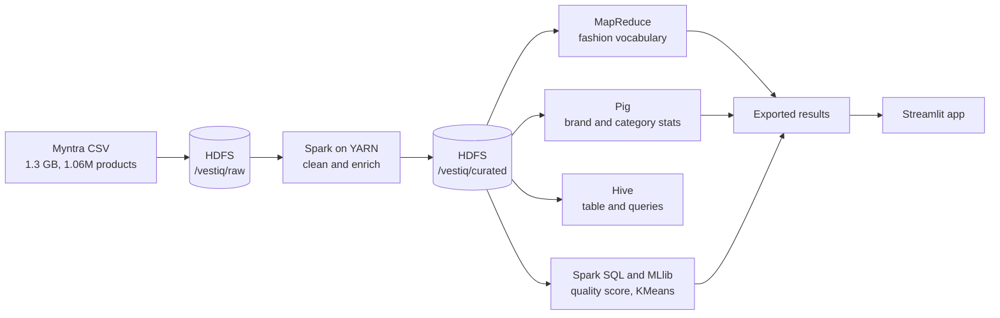

# Vestiq: Fashion Search on a Hadoop + Spark Pipeline

An end-to-end big data project: **1.06 million Myntra products (1.3 GB)** processed on a **3-node Hadoop cluster**
with HDFS, YARN, MapReduce, Pig, Hive and Apache Spark, served through a natural-language search app.

**Live demo:** [VESTIQ](https://vestiq.streamlit.app/)

Try: `simple traditional kurti for wedding under 1500`, `men cotton tshirt under 500`, `cute party dress under 3000`.

## What it does

- Loads a 1.3 GB product catalogue into **HDFS** (replication 2 across two DataNodes).
- Cleans it with **Spark on YARN**: multi-line quoted CSV, type casting, de-duplication, derived columns.
- Mines the fashion vocabulary with **MapReduce** (Hadoop Streaming), computes brand and category statistics with **Pig**,
  and exposes the data as a **Hive** table.
- Scores products with **Spark SQL** (Bayesian-adjusted rating plus popularity) and segments them with **Spark MLlib KMeans**.
- Serves a **Streamlit** app that understands queries such as "party dress under 3000" (budget, gender, keywords)
  and ranks results by text match, quality and discount.

## Architecture



## Cluster

| Node | Role | Resources |
|---|---|---|
| master | NameNode, ResourceManager, Hive metastore, Spark driver | 2 vCPU, 4 GB RAM, 50 GB disk |
| worker2 | DataNode, NodeManager | 2 vCPU, 4 GB RAM, 40 GB disk |
| worker3 | DataNode, NodeManager | 2 vCPU, 4 GB RAM, 50 GB disk |

Three VirtualBox VMs (Ubuntu Server 22.04) on three laptops, bridged to one Wi-Fi network.
Versions: Hadoop 3.3.6, Spark 3.5.3, Hive 3.1.3, Pig 0.17.0, Java 8, Python 3.10.
YARN limits per node: 2048 MB and 2 vCores. Configuration files are in [`cluster/conf`](cluster/conf).

## Pipeline

| Stage | Folder | Tool | What it does |
|---|---|---|---|
| 1. Ingest | [`01_ingest`](01_ingest) | HDFS | Loads the raw CSV into `/vestiq/raw` |
| 2. Vocabulary | [`02_mapreduce`](02_mapreduce) | MapReduce (Streaming) | Word counts over product descriptions |
| 3. Analytics | [`03_pig`](03_pig) | Pig | Brand and category statistics |
| 4. Warehouse | [`04_hive`](04_hive) | Hive | External table over the curated data, queries |
| 5. Processing | [`05_spark`](05_spark) | Spark SQL and MLlib on YARN | Cleaning, quality scoring, KMeans segments |
| 6. App | [`app`](app) | Streamlit | Natural-language product search |

## Key results

- **1,060,213** cleaned products processed with Spark SQL on YARN
- Largest category: **tshirts** (150,918 products, average price Rs 824)
- **404** product categories analysed with Pig
- KMeans segmentation: **6 segments**, silhouette score **0.58**
- Most frequent description words (MapReduce): men, printed, cotton, women, shirt, blue, black, white

## Engineering notes

- **Multi-line CSV:** product rows contain line breaks in the image field, which breaks every line-based tool (MapReduce, Pig, Hive).
  One Spark pass (`multiLine=true`) rewrites it as one row per line and drops the huge image column.
- **Slow inter-node link:** bulk transfer between the laptops ran at only 60 to 200 kB/s. Derived data is written with
  replication 1, Spark loads its jars from each node's local disk (`local:` jars) instead of uploading them every job,
  and MapReduce uses a combiner to keep the shuffle small.
- **Hive:** Hive-on-MR submits a job per query, which was too slow on this network, so Hive serves the table and light queries
  and the heavy aggregations run in Spark SQL.
- **Limits:** a May 2023 snapshot with no purchase history, so there is no personalisation; occasion and synonym handling
  in the app is a hand-made dictionary; the app searches the 100,000 highest-quality products.

## Run the app locally

```
pip install -r requirements.txt
streamlit run app/app.py
```

## Reproduce the pipeline

See [`cluster/SETUP.md`](cluster/SETUP.md) for the cluster build, then run the scripts in the numbered folders in order.

## Data and licence

Dataset: [Myntra Products Dataset](https://www.kaggle.com/datasets/ronakbokaria/myntra-products-dataset) by Ronak Bokaria, CC0 (public domain).
Code: MIT, see [LICENSE](LICENSE).

## Team

Bhumika Anushka Yeggina, Karimireddy Likith Reddy, Ginjupalli Tamoghna Sriram.
Big Data Analytics Integrated Lab (DSE 3125), 5th semester, Section B.
